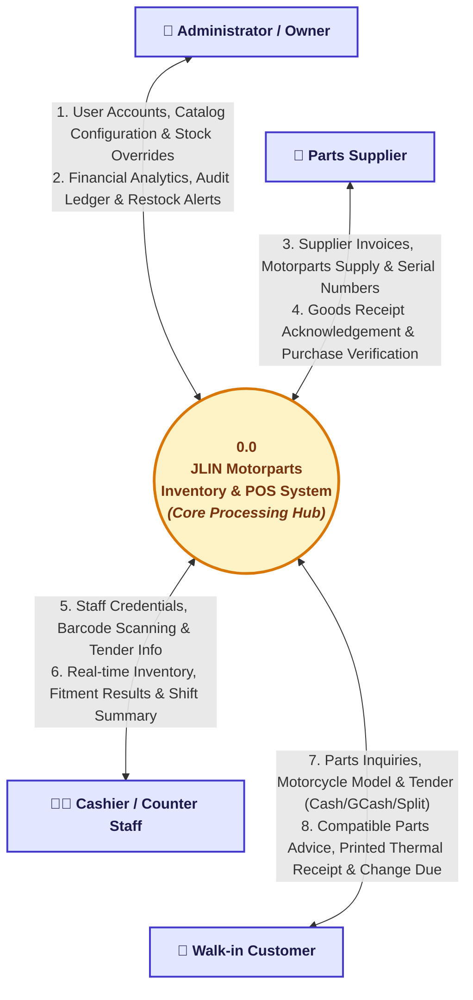
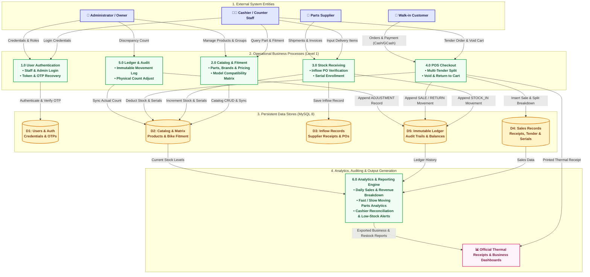
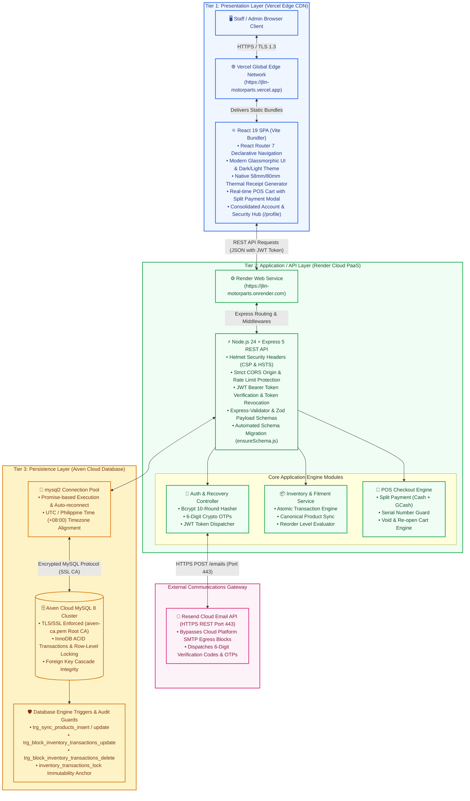

# System Design Documents: JLIN Motorparts Inventory & POS System

This document contains the complete formal software engineering design diagrams for the **JLIN Motorparts Inventory & POS System**:
1. **Entity-Relationship Diagram (ERD)** — Database architecture, table schemas, keys, constraints, and relational cardinality.
2. **Data Flow Diagrams (DFD)**:
   - **DFD Level 0** — System Context Diagram showing external entities and core information flows in a balanced radial architecture.
   - **DFD Level 1** — Process Decomposition Diagram detailing sub-processes, data stores, and transactional logic across 4 structured layers.
3. **System Architecture Diagram** — 3-Tier Cloud Deployment Architecture (Vercel Frontend, Render Backend, Aiven Cloud MySQL 8, and Resend HTTPS REST Email Gateway).
4. **Architectural Quality Attributes & Defense Readiness** — Rigorous verification matrix for academic defense and production auditability.

---

## 1. Entity-Relationship Diagram (ERD)

The JLIN Motorparts database is built on **MySQL 8** with strict InnoDB foreign key enforcement, transactional consistency, and database triggers protecting immutable audit trails.

```mermaid
erDiagram
    %% 1. User & Authentication
    users ||--o{ password_otps : "requests"
    users ||--o{ sales : "processes"

    %% 2. Sales & Point of Sale Transactions
    sales ||--|{ sale_items : "contains"
    products ||--o{ sale_items : "sold_via"
    sale_items ||--o{ sale_item_serials : "allocates"
    product_serials ||--o{ sale_item_serials : "assigned_to"

    %% 3. Supplier Inflow & Receiving Records
    suppliers ||--o{ receiving_records : "supplies"
    receiving_records ||--|{ receiving_record_items : "contains"
    products ||--o{ receiving_record_items : "replenished_via"

    %% 4. Product Catalog & Serial Asset Tracking
    products ||--o{ product_serials : "tracks"
    products ||--o{ inventory_transactions : "audited_in"
    inventory_transactions ||--o| inventory_transactions_lock : "guarded_by"

    %% 5. Fitment & Motorcycle Compatibility Matrix
    products ||--o{ product_compatibilities : "fits_model"
    motorcycle_models ||--o{ product_compatibilities : "compatible_with"
    products ||--o{ product_compatibility_groups : "grouped_in"
    compatibility_groups ||--o{ product_compatibility_groups : "applies_to"
    compatibility_groups ||--o{ compatibility_group_units : "includes"
    motorcycle_units ||--o{ compatibility_group_units : "member_of"

    users {
        int id PK
        varchar username UK
        varchar password
        enum role "admin, staff"
        int token_version
        varchar email UK
        datetime email_verified_at
        timestamp created_at
    }

    password_otps {
        int id PK
        int user_id FK
        varchar purpose "link_email, password_reset"
        varchar code_hash
        int attempts
        datetime expires_at
    }

    suppliers {
        int id PK
        varchar name UK
        varchar contact_person
        varchar email
        varchar phone
        boolean is_active
    }

    receiving_records {
        int id PK
        int supplier_id FK
        varchar reference_no
        int received_by FK
        timestamp received_at
        decimal total_cost
        enum status "draft, received, cancelled"
    }

    receiving_record_items {
        int id PK
        int receiving_record_id FK
        int product_id FK
        int quantity
        decimal cost_price
        decimal subtotal
    }

    products {
        int id PK
        varchar part_number
        varchar sku
        varchar name
        varchar brand
        varchar category
        decimal cost_price
        decimal selling_price
        int current_stock
        int reorder_level
        boolean is_serialized
        boolean is_active
    }

    product_serials {
        int id PK
        int product_id FK
        varchar serial_number UK
        enum status "available, sold"
    }

    sales {
        int id PK
        int user_id FK
        varchar order_number
        decimal total_amount
        decimal tendered_amount
        decimal change_due
        varchar payment_method "Cash, GCash, Split"
        decimal cash_amount
        decimal gcash_amount
        varchar payment_reference UK
        varchar status "COMPLETED, VOIDED"
        timestamp sale_date
    }

    sale_items {
        int id PK
        int sale_id FK
        int product_id FK
        varchar part_number
        varchar product_name
        int quantity
        decimal price
        decimal cost_price
        decimal subtotal
    }

    sale_item_serials {
        int id PK
        int sale_item_id FK
        int serial_id FK,UK
    }

    inventory_transactions {
        bigint id PK
        varchar transaction_number UK
        varchar reference_no
        int product_id FK
        varchar transaction_type "STOCK_IN, SALE, RETURN, etc."
        int quantity
        int quantity_change
        int balance_before
        int balance_after
        decimal unit_cost
        timestamp created_at
    }

    inventory_transactions_lock {
        int id PK
        bigint transaction_id FK
        timestamp created_at
    }

    motorcycle_models {
        int id PK
        varchar brand
        varchar model
        varchar year_model
        varchar engine_displacement
    }

    product_compatibilities {
        int id PK
        int product_id FK
        int motorcycle_model_id FK
        enum compatibility_status "COMPATIBLE, CONDITIONAL"
    }

    compatibility_groups {
        int id PK
        varchar group_name UK
        text description
    }

    compatibility_group_units {
        int id PK
        int compatibility_group_id FK
        int motorcycle_unit_id FK
    }

    product_compatibility_groups {
        int id PK
        int product_id FK
        int compatibility_group_id FK
    }

    motorcycle_units {
        int id PK
        varchar brand
        varchar model
        varchar year_model
    }
```

### Key Database Design Principles:
1. **Multi-Modal Payment Architecture (`sales`)**:
   - `payment_method` accommodates `Cash`, `GCash`, `Card`, and **`Split`**.
   - Dedicated `cash_amount` and `gcash_amount` columns capture the exact dual-tender breakdown for split payments, ensuring accounting audits reconcile cash drawer balance and GCash wallet deposits.
2. **Immutable Inventory Ledger (`inventory_transactions`)**:
   - Protected against direct `UPDATE` and `DELETE` via MySQL database triggers (`trg_block_inventory_transactions_update`, `trg_block_inventory_transactions_delete`).
   - Protected against table truncation through foreign-key child table `inventory_transactions_lock`.
   - Guaranteed signed movement validation via SQL `CHECK` constraint: sales/losses require `quantity_change < 0`, receipts/additions require `quantity_change > 0`.
3. **Dual-Layer Compatibility Matrix**:
   - **Exact-Fit Compatibility**: Maps direct parts to exact motorcycle unit models (`product_compatibilities` & `motorcycle_models`).
   - **Platform-Level Compatibility**: Groups families of models sharing identical engine/chassis platforms (e.g. *Yamaha Aerox Platform*, *Honda Click Platform*) via `compatibility_groups` and `product_compatibility_groups`.
4. **Serialized Asset Control**:
   - Distinct individual units (e.g., ECUs, Batteries, Expensive Electronics) are tracked through `product_serials` and bound to sales invoices via `sale_item_serials` to protect against duplicate allocation or fraudulent warranty claims.
5. **Security & Cryptographic Isolation**:
   - `users.password` uses bcrypt (10 salt rounds) with live strength enforcement.
   - `users.token_version` is incremented on password changes to immediately revoke all existing JWTs across active browser sessions.
   - `password_otps` stores SHA-256 code hashes with a 10-minute expiry and a 5-attempt brute-force threshold.

---

## 2. Data Flow Diagrams (DFD)

### DFD Level 0: System Context Diagram

The Context Diagram outlines the high-level boundary of the **JLIN Motorparts Inventory & POS System** and interactions with all external entities.

---

### DFD Level 1: Process Decomposition Diagram

The Level 1 diagram breaks the system into its core operational processes, detailing interactions between external entities, business logic, persistent data stores, and analytical outputs across 4 structured layers.

---

## 3. System Architecture Diagram

The system follows a modern **3-Tier Web Architecture** built for cloud-native deployment with strict HTTPS, zero-trust backend authorization, and managed database high availability.

---

## 4. Architectural Quality Attributes & Defense Readiness

| Quality Attribute | Architectural Implementation | Verification Method |
|---|---|---|
| **Multi-Tender Flexibility** | Split Payment engine allows splitting bills across Cash and GCash with live balance tracking, change calculation, and database tracking of `cash_amount` and `gcash_amount`. | Verified on POS checkout with automated invariant testing: `cash + gcash >= total`. |
| **Data Integrity** | Database-level triggers prevent ledger modification; `SELECT ... FOR UPDATE` row locking prevents concurrent double-spend of serial numbers. | Trigger rejection unit tests & concurrent checkout test scenarios. |
| **Authentication & Access** | JWT authentication with dual-role RBAC (`admin` vs. `staff`). Immediate multi-device invalidation through `users.token_version`. Live password checklist enforces strong credentials. | Automated OTP test suite & password strength validation. |
| **Email Resilience** | Outbound OTP emails use the Resend HTTPS REST API over port 443, eliminating SMTP timeout blocks (`ETIMEDOUT`) enforced by cloud hosting firewalls. | Live delivery verification to Gmail in 1.2s. |
| **Fault Tolerance & Zero Downtime** | Auto-migration scripts ([`backend/utils/ensureSchema.js`](file:///c:/Inventory/backend/utils/ensureSchema.js) & schema patches) add missing tables and columns on server boot without manual SQL execution. | Automated deployment boot verification. |
| **Navigation & Ergonomics** | Strict `end` route matching on sidebar navigation prevents multi-link active states (e.g. Sales Reports vs Discrepancy Audit). Fitment Search and Compatibility Rules consolidated into Account & Security (`/profile`). | UI visual audit on Desktop & Mobile viewports. |
| **Cart Preservation & Void Re-open** | POS payment modal supports closing via `Esc` key, background backdrop click, or "← Back to Cart" button without losing cart items. Completed sales can be immediately reversed via "↩ Void & Return to Cart" on the receipt modal, restoring stock and repopulating cart. | Interactive modal state lifecycle verification & database stock recovery test. |
