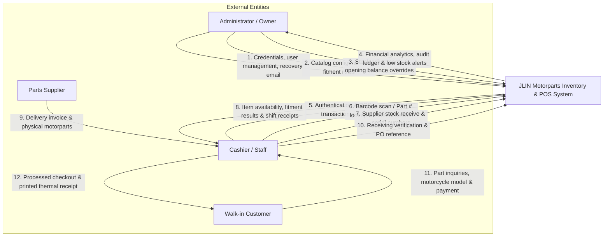
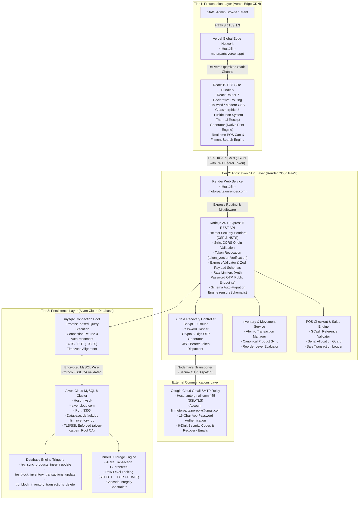

# System Design Documents: JLIN Motorparts Inventory & POS System

This document contains the complete formal software engineering design diagrams for the **JLIN Motorparts Inventory & POS System**:
1. **Entity-Relationship Diagram (ERD)** — Database architecture, table schemas, keys, constraints, and relational cardinality.
2. **Data Flow Diagrams (DFD)**:
   - **DFD Level 0** — System Context Diagram showing external entities and core information flows.
   - **DFD Level 1** — Process Decomposition Diagram detailing sub-processes, data stores, and transactional logic.
3. **System Architecture Diagram** — 3-Tier Cloud Deployment Architecture (Vercel Frontend, Render Backend, Aiven Cloud MySQL 8, and Google SMTP Relay).

---

## 1. Entity-Relationship Diagram (ERD)

The JLIN Motorparts database is built on **MySQL 8** with strict InnoDB foreign key enforcement, transactional consistency, and database triggers protecting immutable audit trails.

```mermaid
erDiagram
    users ||--o{ password_otps : "requests"
    users ||--o{ receiving_records : "receives"
    users ||--o{ sales : "processes"
    users ||--o{ inventory_transactions : "logs"

    suppliers ||--o{ receiving_records : "supplies"
    receiving_records ||--|{ receiving_record_items : "contains"
    products ||--o{ receiving_record_items : "replenished_via"

    products ||--o{ product_serials : "tracks"
    products ||--o{ sale_items : "sold_via"
    products ||--o{ inventory_transactions : "audited_in"
    products ||--o{ product_compatibilities : "fits_model"
    products ||--o{ product_compatibility_groups : "grouped_in"

    motorcycle_models ||--o{ product_compatibilities : "compatible_with"
    motorcycle_units ||--o{ compatibility_group_units : "member_of"

    compatibility_groups ||--o{ compatibility_group_units : "includes"
    compatibility_groups ||--o{ product_compatibility_groups : "applies_to"

    sales ||--|{ sale_items : "contains"
    sale_items ||--o{ sale_item_serials : "allocates"
    product_serials ||--o{ sale_item_serials : "assigned_to"

    inventory_transactions ||--o| inventory_transactions_lock : "guarded_by"

    users {
        int id PK
        varchar username UK
        varchar password
        enum role "admin, staff"
        int token_version
        varchar email UK
        datetime email_verified_at
        timestamp created_at
        timestamp updated_at
    }

    password_otps {
        int id PK
        int user_id FK
        varchar purpose "link_email, password_reset"
        varchar code_hash
        int attempts
        datetime expires_at
        datetime used_at
        timestamp created_at
    }

    suppliers {
        int id PK
        varchar name UK
        varchar contact_person
        varchar email
        varchar phone
        text address
        boolean is_active
        timestamp created_at
        timestamp updated_at
    }

    products {
        int id PK
        varchar part_number
        varchar sku
        varchar name
        varchar brand
        varchar category
        varchar size
        varchar measurement
        varchar thread_type
        decimal cost_price
        decimal selling_price
        decimal retail_price
        int stock
        int current_stock
        int reorder_level
        boolean is_serialized
        boolean is_active
        timestamp created_at
        timestamp updated_at
    }

    product_serials {
        int id PK
        int product_id FK
        varchar serial_number UK
        enum status "available, sold"
        timestamp created_at
    }

    motorcycle_units {
        int id PK
        varchar brand
        varchar model
        varchar year_model
    }

    motorcycle_models {
        int id PK
        varchar brand
        varchar model
        int year_start
        int year_end
        varchar year_model
        varchar engine_displacement
        timestamp created_at
    }

    product_compatibilities {
        int id PK
        int product_id FK
        int motorcycle_model_id FK
        enum compatibility_status "COMPATIBLE, NOT_COMPATIBLE, CONDITIONAL"
        varchar notes
        timestamp created_at
    }

    compatibility_groups {
        int id PK
        varchar group_name UK
        text description
    }

    compatibility_group_units {
        int id PK
        int compatibility_group_id FK
        int motorcycle_unit_id FK
    }

    product_compatibility_groups {
        int id PK
        int product_id FK
        int compatibility_group_id FK
    }

    receiving_records {
        int id PK
        int supplier_id FK
        varchar reference_number
        varchar reference_no
        int received_by FK
        timestamp received_at
        decimal total_cost
        enum status "draft, received, cancelled"
        text notes
        timestamp created_at
    }

    receiving_record_items {
        int id PK
        int receiving_record_id FK
        int product_id FK
        int quantity
        decimal cost_price
        decimal subtotal
        timestamp created_at
    }

    sales {
        int id PK
        int user_id FK
        varchar order_number
        decimal total_amount
        decimal tendered_amount
        decimal change_due
        enum payment_method "Cash, GCash, Card"
        varchar payment_reference UK
        varchar payment_provider
        varchar payment_status
        timestamp sale_date
    }

    sale_items {
        int id PK
        int sale_id FK
        int product_id FK
        varchar part_number
        varchar product_name
        varchar brand
        varchar size
        int quantity
        decimal price
        decimal cost_price
        decimal subtotal
    }

    sale_item_serials {
        int id PK
        int sale_item_id FK
        int serial_id FK,UK
    }

    inventory_transactions {
        bigint id PK
        varchar transaction_number UK
        varchar reference_no
        int product_id FK
        varchar transaction_type "STOCK_IN, SALE, DAMAGE, LOSS, OPENING_BALANCE, etc."
        int quantity
        int quantity_change
        int balance_before
        int balance_after
        decimal unit_cost
        varchar reference_type
        int reference_id
        text remarks
        int created_by FK
        timestamp created_at
    }

    inventory_transactions_lock {
        int id PK
        bigint transaction_id FK
        timestamp created_at
    }
```

### Key Database Design Principles:
1. **Immutable Inventory Ledger (`inventory_transactions`)**:
   - Protected against direct `UPDATE` and `DELETE` via MySQL database triggers (`trg_block_inventory_transactions_update`, `trg_block_inventory_transactions_delete`).
   - Protected against table truncation through foreign-key child table `inventory_transactions_lock`.
   - Guaranteed signed movement validation via SQL `CHECK` constraint: sales/losses require `quantity_change < 0`, receipts/additions require `quantity_change > 0`.
2. **Dual-Layer Compatibility Matrix**:
   - **Exact-Fit Compatibility**: Maps direct parts to exact motorcycle unit models (`product_compatibilities` & `motorcycle_models`).
   - **Platform-Level Compatibility**: Groups families of models sharing identical engine/chassis platforms (e.g. *Yamaha Aerox Platform*, *Honda Click Platform*) via `compatibility_groups` and `product_compatibility_groups`.
3. **Serialized Asset Control**:
   - Distinct individual units (e.g., ECUs, Batteries, Expensive Electronics) are tracked through `product_serials` and bound to sales invoices via `sale_item_serials` to protect against duplicate allocation or fraudulent warranty claims.
4. **Security & Cryptographic Isolation**:
   - `users.password` uses bcrypt (10 salt rounds).
   - `users.token_version` is incremented on password changes to immediately revoke all existing JWTs across active browser sessions.
   - `password_otps` stores SHA-256 code hashes with a 10-minute expiry and a 5-attempt brute-force threshold.

---

## 2. Data Flow Diagrams (DFD)

### DFD Level 0: System Context Diagram

The Context Diagram outlines the high-level boundary of the **JLIN Motorparts Inventory & POS System** and interactions with all external entities.

---

### DFD Level 1: Process Decomposition Diagram

The Level 1 diagram breaks the system into its six core operational processes, detailing interactions with the data stores.

```mermaid
flowchart TD
    %% Entities
    Admin["Admin"]
    Staff["Cashier / Staff"]
    Customer["Customer"]
    Supplier["Supplier"]

    %% Data Stores
    D1[("D1: Users & Auth OTPs")]
    D2[("D2: Product & Fitment Catalog")]
    D3[("D3: Suppliers & Receiving Records")]
    D4[("D4: POS Sales & Serial Allocation")]
    D5[("D5: Immutable Inventory Ledger")]

    %% Process 1: Auth & OTP Recovery
    subgraph P1 ["1.0 Authentication & Password Recovery"]
        P1_1["1.1 Login & JWT Token Dispatch"]
        P1_2["1.2 Email OTP Verification"]
        P1_3["1.3 Session Revocation"]
    end

    Admin -->|"Username, Password, OTP"| P1_1
    Staff -->|"Username, Password"| P1_1
    P1_1 <-->|"Verify credentials & token_version"| D1
    P1_2 <-->|"Validate 6-digit OTP hash & expiry"| D1
    P1_3 -->|"Bump token_version on password reset"| D1

    %% Process 2: Catalog & Fitment
    subgraph P2 ["2.0 Product & Fitment Matrix Management"]
        P2_1["2.1 Product Catalog CRUD"]
        P2_2["2.2 Platform Group Compatibility"]
        P2_3["2.3 Fitment Search Engine"]
    end

    Admin -->|"Manage Products, Prices, Platforms"| P2_1
    Admin -->|"Define Platform Groups & Models"| P2_2
    P2_1 <-->|"Read / Write Catalog"| D2
    P2_2 <-->|"Link Groups & Models"| D2
    Staff -->|"Search by Bike Brand / Model / Part #"| P2_3
    P2_3 <-->|"Query Compatible Parts"| D2

    %% Process 3: Stock Inflow
    subgraph P3 ["3.0 Stock Receiving & Supplier Inflow"]
        P3_1["3.1 Supplier & Receipt Verification"]
        P3_2["3.2 Item Quantity & Cost Check"]
        P3_3["3.3 Serial Number Enrollment"]
    end

    Supplier -->|"Delivery Slip & Parts"| Staff
    Staff -->|"Input Supplier Receipt & Qty"| P3_1
    P3_1 <-->|"Verify Supplier"| D3
    P3_2 -->|"Store Inflow Records"| D3
    P3_2 -->|"STOCK_IN movement"| D5
    P3_2 -->|"Increment current_stock"| D2
    P3_3 -->|"Register Serial Numbers"| D2

    %% Process 4: Point of Sale
    subgraph P4 ["4.0 Point of Sale & Checkout"]
        P4_1["4.1 Cart Building & Stock Check"]
        P4_2["4.2 Payment & Tender Calculation"]
        P4_3["4.3 Serial Number Assignment"]
        P4_4["4.4 Receipt Generation"]
    end

    Staff -->|"Scan / Select Items"| P4_1
    P4_1 <-->|"Validate available stock"| D2
    Customer -->|"Cash / GCash Payment"| Staff
    Staff -->|"Tender Payment & Order"| P4_2
    P4_2 -->|"Insert Sale Record"| D4
    P4_3 <-->|"Mark Serials as SOLD"| D2
    P4_3 -->|"Link Serials to Sale Item"| D4
    P4_2 -->|"SALE deduction movement"| D5
    P4_2 -->|"Decrement current_stock"| D2
    P4_4 -->|"Official Printed Receipt"| Customer

    %% Process 5: Immutable Ledger & Audit
    subgraph P5 ["5.0 Immutable Ledger & Inventory Audit"]
        P5_1["5.1 Transaction Logger"]
        P5_2["5.2 Physical Count Audit"]
    end

    D5 <-->|"Append-only movement entry"| P5_1
    Admin -->|"Log Discrepancy Adjustment"| P5_2
    P5_2 -->|"ADJUSTMENT_ADD / LOSS record"| D5
    P5_2 -->|"Synchronize current_stock"| D2

    %% Process 6: Reports & Analytics
    subgraph P6 ["6.0 Reports & Business Analytics"]
        P6_1["6.1 Sales & Revenue Reports"]
        P6_2["6.2 Fast / Slow Moving Parts"]
        P6_3["6.3 Cashier Sales Breakdown"]
    end

    D4 -->|"Sales Data"| P6_1
    D5 -->|"Movement History"| P6_2
    D4 -->|"User Sales Log"| P6_3
    P6_1 -->|"Exportable Reports & Graphs"| Admin
    P6_2 -->|"Restock Recommendations"| Admin
    P6_3 -->|"Cashier Reconciliation"| Admin
```

---

## 3. System Architecture Diagram

The system follows a modern **3-Tier Web Architecture** built for cloud-native deployment with strict HTTPS, zero-trust backend authorization, and managed database high availability.

---

## 4. Architectural Quality Attributes & Defense Readiness

| Quality Attribute | Architectural Implementation | Verification Method |
|---|---|---|
| **Data Integrity** | Database-level triggers prevent ledger modification; `SELECT ... FOR UPDATE` row locking prevents concurrent double-spend of serial numbers. | Trigger rejection unit tests & Phase 2 concurrent checkout tests. |
| **Authentication & Access** | JWT authentication with dual-role RBAC (`admin` vs. `staff`). Immediate multi-device invalidation through `users.token_version`. | Automated OTP test suite (Scenario 9 verified). |
| **Fault Tolerance & Zero Downtime** | Auto-migration engine ([`backend/utils/ensureSchema.js`](file:///c:/Inventory/backend/utils/ensureSchema.js)) checks and adds missing tables on server boot without manual SQL execution. | Automated Render deployment boot verification. |
| **Security & Privacy** | Passwords stored with Bcrypt (10 rounds); OTP codes stored with SHA-256 hashes; secrets strictly loaded from environment variables (`.env`). | `.gitignore` enforcement; git check-ignore verification. |
| **Fitment Accuracy** | Hybrid fitment model: Exact model matching combined with platform-level shared groupings. | Real-time fitment search testing with Aerox, Click, and Raider platforms. |
