# System Use Case Diagram — J-Lin Motorparts Inventory & POS

The use case diagram below details the operational interactions between the system actors (**Owner / Admin** and **Cashier / Staff**) across all modules of the **J-Lin Motorparts Inventory & POS System**.

```mermaid
flowchart LR
    Owner["👤 Owner / Admin"]
    Cashier["👤 Cashier / Staff"]

    subgraph System ["J-Lin Motorparts Inventory & POS System"]
        subgraph AuthMod ["Authentication & Security"]
            UC_Auth(["Login & Session Authentication"])
            UC_OTP(["Generate 6-Digit Admin OTP Discount"])
        end

        subgraph POSMod ["Sale (POS) Module"]
            UC_Sale(["Ring Up Sale (Cash & GCash)"])
            UC_Hold(["Hold & Resume Active Carts"])
            UC_Swap(["Process Item Swap / Exchange Mode"])
            UC_Void(["Verify Same-Day Void Receipt"])
        end

        subgraph InvMod ["Inventory & Catalog"]
            UC_Browse(["View Catalog (Selling Price Only)"])
            UC_Catalog(["Manage Parts, Categories & Brands"])
            UC_Damage(["Log In-Store Damage Adjustment"])
            UC_Reorder(["View Low-Stock Reorder Alerts"])
        end

        subgraph StockInMod ["Receiving / Stock-In"]
            UC_Receive(["Inspect Truck Delivery & Paper DR"])
            UC_Reject(["Reject Damaged Stock to Driver"])
            UC_Payout(["Log Supplier Cash Restock Payout"])
        end

        subgraph SuppMod ["Suppliers Module"]
            UC_Suppliers(["Manage Facebook Supplier Directory"])
        end

        subgraph DrawerMod ["Shifts & Cash Drawer"]
            UC_Float(["Time-In Cashier & Assign Starting Float"])
            UC_ShiftLock(["Lock / Unlock Cashier POS Terminal"])
            UC_BlindCount(["Submit End-of-Shift Blind Cash Count"])
            UC_SignOff(["Audit & Sign Off Shift Remittance"])
        end

        subgraph RepMod ["Reports & Financial Intelligence"]
            UC_Profit(["View True Net Profit & Puhunan Margin"])
            UC_CashFlow(["Track Real Cash Inflow vs. Truck Outflows"])
            UC_Velocity(["Analyze Stock Velocity (Fast / Dead Stock)"])
            UC_Exports(["Export CSV & Print PDF Reference Logs"])
        end

        subgraph AuditMod ["Staff & Audit Log"]
            UC_Staff(["Manage User Accounts & Roles"])
            UC_Audit(["Inspect Tamper-Proof Audit Logs"])
        end
    end

    %% Cashier / Staff Connections
    Cashier --- UC_Auth
    Cashier --- UC_Sale
    Cashier --- UC_Hold
    Cashier --- UC_Swap
    Cashier --- UC_Browse
    Cashier --- UC_Reorder
    Cashier --- UC_BlindCount

    %% Owner / Admin Connections (Full Access)
    Owner --- UC_Auth
    Owner --- UC_OTP
    Owner --- UC_Sale
    Owner --- UC_Hold
    Owner --- UC_Swap
    Owner --- UC_Void
    Owner --- UC_Browse
    Owner --- UC_Catalog
    Owner --- UC_Damage
    Owner --- UC_Reorder
    Owner --- UC_Receive
    Owner --- UC_Reject
    Owner --- UC_Payout
    Owner --- UC_Suppliers
    Owner --- UC_Float
    Owner --- UC_ShiftLock
    Owner --- UC_SignOff
    Owner --- UC_Profit
    Owner --- UC_CashFlow
    Owner --- UC_Velocity
    Owner --- UC_Exports
    Owner --- UC_Staff
    Owner --- UC_Audit
```

---

### Role-Based Access Control (RBAC) Summary

| Feature / Use Case | Cashier / Staff | Owner / Admin | Purpose & Access Boundary |
|---|:---:|:---:|---|
| **POS Sales & Receipts** | ✅ Allowed | ✅ Allowed | Ringing up motorparts via barcode/SKU, accepting Cash and GCash. |
| **Cart Holding** | ✅ Allowed | ✅ Allowed | Parking unfinished sales when customers step away to grab another part. |
| **Item Swap Mode** | ✅ Allowed | ✅ Allowed | Looking up past receipts, crediting returned items, and collecting top-ups. |
| **Voiding Receipts** | ❌ Blocked | ✅ Allowed | Voiding completed transactions requires Admin authentication. |
| **Admin OTP Discounts** | ❌ Request Only | ✅ Allowed | 6-digit dynamic OTP generated by Admin to approve counter discounts. |
| **Inventory Catalog** | 👁️ Catalog View | ✅ Full Access | Cashier sees part names & retail price; Owner sees cost (*puhunan*) & margins. |
| **Add / Edit / Delete Categories & Brands** | ❌ Blocked | ✅ Allowed | Owner manages catalog structure and reassigns parts when deleting. |
| **Receiving / Stock-In** | ❌ Blocked | ✅ Allowed | Inspecting supplier truck deliveries, rejecting defects, logging cash payouts. |
| **Supplier Directory** | ❌ Blocked | ✅ Allowed | Managing supplier contacts, Messenger links, and wholesale ordering. |
| **Cash Float & Drawer Controls** | ❌ Blocked | ✅ Allowed | Admin times in staff, assigns starting change float, and controls terminal access. |
| **Shift Blind Count** | ✅ Submit Only | ✅ Verification | Cashier counts physical cash blindly without seeing expected totals. |
| **Financial & Profit Reports** | ❌ Blocked | ✅ Allowed | True Net Profit, inventory velocity, cash flow, and supplier truck spending. |
| **Staff & Audit Logs** | ❌ Blocked | ✅ Allowed | Creating accounts, resetting PINs, and reviewing tamper-evident logs. |
